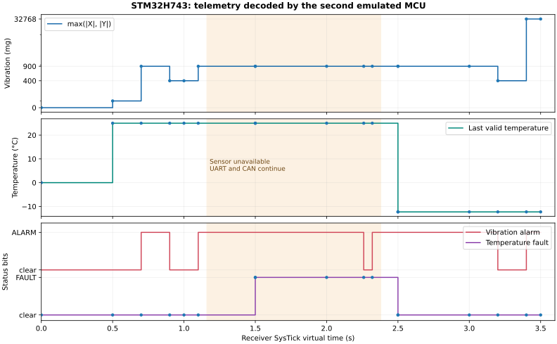
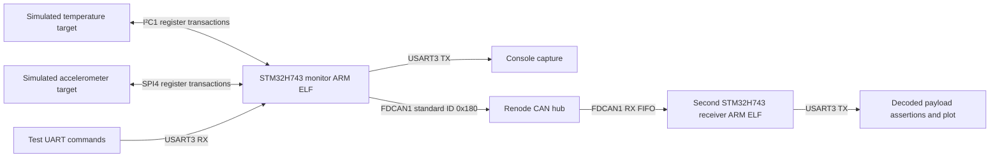

# STM32 Machine Health Monitor



**Reproduce this plot and its assertions: `make demo`** (setup below). Target: **STM32H743, ARM Cortex-M7**. Emulated interfaces: **USART3 UART, I²C1, SPI4, FDCAN1 in Classical CAN mode, and Cortex-M SysTick**. Two independent MCU instances exchange frames over a Renode CAN hub.

The plot contains observations from a successful run of the compiled ARM firmware, decoded by the receiving MCU. The shaded interval marks a temperature sensor that stops responding. UART commands and CAN telemetry continue throughout that fault. Full evidence: [receiver and console trace](evidence/demo.txt), [machine-readable results and ELF hashes](evidence/integration.json), and [early H743 bus probe](evidence/probe.txt).

| Receiver virtual time | Observation | Actual eight-byte CAN payload |
| --- | --- | --- |
| 500 ms | 25.0°C, 100 mg, no faults | `fa00640000010000` |
| 700 ms | 900 mg exceeds the new 400 mg threshold | `fa00840301020000` |
| 900 ms | 400 mg equals the threshold: alarm clears | `fa00900100030000` |
| 1500 ms | Temperature response missing; both flags set | `fa00840303060000` |
| 2000 ms | Periodic CAN continues during the temperature fault | `fa00840303080000` |
| 2500 ms | Sensor restored at −12.3°C; temperature fault clears | `85ff8403010b0000` |

## Build and reproduce

On Linux x86-64, install a host C compiler, GNU Make, Python 3, curl, and tar. The plot also needs Matplotlib; on Debian/Ubuntu:

```sh
sudo apt-get install build-essential python3-matplotlib curl ca-certificates
./tools/bootstrap.sh
make all
make host-test
make probe
make integration
make demo
```

`bootstrap.sh` downloads checksum-verified, pinned portable ARM GCC and Renode archives into `.tools/` in this repository. It skips tools that are already installed there. Existing tools on `PATH` take precedence; the build also discovers compatible installations under `$HOME/tools`. To select exact executables:

```sh
make ARM_GCC=/path/to/arm-none-eabi-gcc RENODE=/path/to/renode demo
```

If Matplotlib is not installed by the OS, use an isolated Python environment:

```sh
python3 -m venv .venv
.venv/bin/python -m pip install -r requirements.txt
make PYTHON=.venv/bin/python demo
```

| Command | Result / artifact |
| --- | --- |
| `make all` | Real Cortex-M7 ARM ELFs: `build/monitor.elf`, `build/receiver.elf` |
| `make host-test` | Native C assertions with AddressSanitizer and UndefinedBehaviorSanitizer |
| `make probe` | Small ARM feasibility firmware exercises all four buses; saves `evidence/probe.txt` |
| `make integration` | Runs both ARM ELFs, changes sensor properties and injects UART input, asserts received CAN payloads; saves `evidence/demo.txt` and `evidence/integration.json` |
| `make demo` | Runs the same integration assertions, then plots the successful receiver trace into `evidence/demo.svg` |

The test uses only Python's standard library and a local Renode Monitor TCP socket. A sandbox must allow localhost sockets and emulator execution. Renode's UART file backends flush when the emulator exits, so assertions read the complete capture after shutdown. Failed runs leave diagnostic logs in `build/renode.log`; they do not create new success evidence. Do not use `python -O`, which disables Python assertions. Runs sharing this directory are protected by an exclusive lock.

## Architecture



The monitor is freestanding Embedded C with a periodic main loop, fixed-size storage, and no heap or RTOS. A 1 ms SysTick ISR only advances a counter. The main loop services at most 16 UART input bytes per pass, reads acceleration every 100 ms, and reads temperature every 500 ms. Unsigned tick subtraction supports timer wraparound. All bus waits are bounded to 10,000 register polls; a missing I²C response cannot trap the application in an infinite polling loop.

[`monitor_core.c`](firmware/monitor_core.c) implements command parsing, alarm transitions, fault retention, and byte serialization independently of the board. [`board.c`](firmware/board.c) implements actual memory-mapped STM32 peripheral transactions. [`monitor.c`](firmware/monitor.c) schedules work and sends startup, periodic, and flag-change telemetry. [`receiver.c`](firmware/receiver.c) runs on the second MCU, reads its CAN receive FIFO, acknowledges each frame, and prints both raw bytes and decoded fields. Tests never substitute a sender log for CAN reception.

Vibration is `max(abs(X), abs(Y))`; Z is read but intentionally excluded. The alarm uses a strict `>` comparison and clears at equality. Negation promotes samples to 32 bits, so `INT16_MIN` produces 32768 mg. A threshold change immediately reevaluates the alarm using the latest sample. A failed temperature read preserves the last valid value and sets the temperature fault bit. A successful read updates the value and clears only that bit.

A pending event frame and a pending periodic frame are tracked separately. When a flag transition coincides with a 500 ms deadline, both frames are sent, as visible at 1500 and 2500 ms. The sequence counter advances only after a frame is successfully queued in the CAN controller; a busy transmit buffer is retried on a later main-loop pass.

## UART console

Nominal console configuration: 115200 baud, 8 data bits, no parity, one stop bit. Commands terminate with LF, CR, or CRLF. Maximum command length is 63 bytes, excluding the terminator.

| Command | Behavior |
| --- | --- |
| `status` | Reports virtual milliseconds, last valid temperature in tenths °C, vibration in mg, threshold, and flags |
| `threshold <mg>` | Accepts an unsigned decimal integer from 100 through 4000; boot default is 1500 mg |
| Invalid argument | `ERR invalid command or threshold (100..4000 mg)` |
| Unknown command | `ERR unknown command` |
| Oversized line | Discards through the terminator and returns `ERR command too long (max 63 bytes)`; the following line works normally |

No signs, extra arguments, or trailing spaces are accepted. Nonprintable bytes are invalid. Parsing checks bounds before decimal accumulation can overflow.

## Simulated sensor register maps

The deterministic sensor implementations are in [`renode/Sensors.cs`](renode/Sensors.cs). They are custom demo devices rather than claims of compatibility with a particular commercial sensor. Multi-byte values use little-endian two's-complement encoding.

**I²C temperature target, 7-bit address `0x48`:** write one register-pointer byte, issue a repeated-start read, then read two bytes from address `0x00`. The register pointer auto-increments.

| Register | Meaning |
| --- | --- |
| `0x00` | Temperature low byte; signed 16-bit value in 0.1°C |
| `0x01` | Temperature high byte |
| `0x02` | Identification byte `0x54` |
| Other addresses | Read as zero |

Default temperature is `250` (25.0°C). `Available=false` makes the target return **no response bytes**, causing the running MCU's receive-ready polling to time out. This tests missing-response handling. Renode 1.17.0 does not implement the STM32F7 I²C model's `NACKF`; a physical NACK/error-flag path is not claimed as verified.

**SPI accelerometer:** transmit `0x80 | register_address`, then clock dummy bytes to read sequential registers. The command response byte is ignored. A seven-byte transaction reads the command plus six data bytes. End-of-transfer resets the device's command state.

| Registers | Meaning |
| --- | --- |
| `0x00`, `0x01` | Signed X in mg, low byte first |
| `0x02`, `0x03` | Signed Y in mg, low byte first |
| `0x04`, `0x05` | Signed Z in mg, low byte first |
| `0x06` | Identification byte `0x41` |
| Other addresses | Read as zero |

Defaults: X = 100 mg, Y = −50 mg, Z = 1000 mg. The firmware uses eight-bit SPI words and the STM32H7 SPI transfer-size and end-of-transfer machinery. Sensor values remain constant until the test changes them.

These are runtime Renode Monitor commands used by the integration test while the emulation is paused between virtual-time intervals:

```text
mach set "monitor"
sysbus.spi4.accel X -900
sysbus.spi4.accel Y 200
sysbus.spi4.accel Z 32000
sysbus.i2c1.sensor Available false
emulation RunFor "1.1"
sysbus.i2c1.sensor Temperature -123
sysbus.i2c1.sensor Available true
emulation RunFor "0.8"
```

Changing a model property changes subsequent peripheral responses; it does not write application state in MCU RAM. [`full_sequence()`](tests/integration.py#L171) contains the complete reproducible runtime scenario and UART injections.

## CAN telemetry contract

Classical CAN data frame, standard 11-bit ID **`0x180`**, DLC **8**, no FD, BRS, RTR, or extended-ID flag. Payload encoding uses explicit byte shifts, with no struct packing or CPU-endianness assumptions.

| Bytes | Encoding |
| --- | --- |
| 0–1 | Signed temperature in tenths °C, little-endian; last valid value, or zero before any successful read |
| 2–3 | Unsigned vibration in mg, little-endian |
| 4 | Bit 0: vibration alarm; bit 1: temperature fault; all other bits zero |
| 5 | Rolling sequence counter, modulo 256, incremented for each successfully queued frame |
| 6–7 | Reserved; always zero |

Transmission occurs once at startup, every 500 ms, and additionally on flag changes. The second MCU configures an eight-element receive FIFO and normal CAN mode; this is not internal controller loopback. Python independently checks the received frame's ID, DLC, frame format, decoded values, exact bytes, reserved fields, and uninterrupted sequence counter.

## Interview walkthrough

Each step runs the application decisions on the emulated ARM MCU. Python controls the scenario; C# sensor models supply sensor data; Renode models the bus controllers and CAN hub.

1. **Boot and acquire baseline data.** [`main()`](firmware/monitor.c#L55) schedules [`temperature_read()`](firmware/board.c#L91) and [`acceleration_read()`](firmware/board.c#L116). The firmware receives 250 and `(100, −50, 1000)`, selects 100 mg, and keeps both flags clear. [`assert_full_sequence()`](tests/integration.py#L243) checks the all-zero startup frame and the baseline receiver payload.
2. **Change policy through UART.** [`console_feed()`](firmware/monitor_core.c#L79) assembles `threshold 400`; [`monitor_command()`](firmware/monitor_core.c#L56) validates the range and stores the threshold. [`console_poll()`](firmware/monitor.c#L18) prints the acknowledgement. The test checks UART acknowledgement and subsequent received CAN behavior, including console use during the temperature fault.
3. **Inject vibration and check the boundary.** The SPI target supplies X = −900, Y = 200, Z = 32000. [`monitor_acceleration()`](firmware/monitor_core.c#L35) selects 900 mg and sets bit 0. The next 400 mg sample clears it because equality is safe. [`assert_stage()`](tests/integration.py#L157) and the alarm assertions in [`assert_full_sequence()`](tests/integration.py#L243) verify the receiving MCU's decoded values and event arrival within one 100 ms sampling interval plus 3 ms tolerance.
4. **Remove temperature responses.** [`temperature_read()`](firmware/board.c#L91) receives no bytes and exits its bounded poll. [`monitor_temperature()`](firmware/monitor_core.c#L28) retains 250 and sets bit 1. [`telemetry_queue()`](firmware/monitor.c#L47) continues transmitting. The test requires at least three received fault frames, verifies every 500 ms deadline, and issues `status` and threshold changes while the fault is active.
5. **Restore the sensor and prove signed encoding.** The target supplies −123. The MCU clears only the temperature fault and serializes `85 ff` in [`monitor_payload()`](firmware/monitor_core.c#L42). The receiver sees −12.3°C with the vibration alarm still set. The test then clears vibration and injects −32768 mg to check safe absolute-value conversion.
6. **Prove reception and input recovery.** [`can_receive()`](firmware/board.c#L148) reads the second controller's receive FIFO; [`receiver.c`](firmware/receiver.c#L2) decodes the bytes on that MCU. [`assert_received_payloads()`](tests/integration.py#L143) checks exact bytes, frame metadata, reserved bytes, and sequence continuity. The final UART assertions reject malformed, out-of-range, unknown, and oversized lines, then accept valid boundary values and a fresh `status` command.

## Validation, target choice, and limits

The H743 was tested first and retained: [`probe.c`](firmware/probe.c) boots a Cortex-M7 ELF, reads both sensor buses, accepts a UART character, and sends a frame that the second MCU receives. [Captured feasibility output](evidence/probe.txt) shows temperature 250, XYZ `(100, −50, 1000)`, and received bytes `fa00640000000000`.

The successful 3.6-second main scenario received **17 frames**. The first alarm arrived **40 ms after injection**, at virtual time 700 ms. Temperature fault reporting began at 1500 ms, **340 ms after the sensor became unavailable**, at the next temperature sampling deadline. Recovery appeared at 2500 ms, **120 ms after restoration**. These delays include scheduled sampling; they are not physical bus-latency measurements. Millisecond timestamps come from the receiver's emulated SysTick. The CAN hub uses a 25 µs global quantum and serial machine execution, matching Renode's own two-node MCAN tests.

Host C tests cover parser bounds and recovery, strict alarm transitions, signed extrema, temperature retention/recovery, exact little-endian bytes, and sequence rollover. AddressSanitizer and UndefinedBehaviorSanitizer are enabled; leak detection is disabled because the firmware core uses no heap and some tracing environments cannot run LeakSanitizer.

Verified tool versions: **Renode 1.17.0.0**, **xPack ARM GCC 15.2.1 20251203**, **host GCC 16.2.1**, **Python 3.14.7**, **Matplotlib 3.10.8**. The capture was produced on Linux x86-64. [Tool provenance, archive hashes, and model investigation](docs/validation.md) describe the exact versions and known model restrictions. CI installs the same pinned Renode and ARM GCC archives and runs the build, host tests, and integration demo.

Validation was performed **in emulation**. MCU instruction execution, SysTick interrupts, UART RX/TX registers, I²C transfers and receive timeout, SPI transfers, CAN message RAM, CAN hub delivery, and the receiving MCU's decoding were exercised. GPIO alternate-function routing, electrical waveforms, bus arbitration/timing, clock-stretching, physical I²C NACK, CAN acknowledgement/error recovery under electrical faults, and real sensors were not validated. The platform fixes SysTick and UART clock assumptions at 64 MHz; timing configuration fields that Renode treats as tags can produce documented warnings. Physical hardware deployment requires a board-specific clock/pin configuration and hardware validation. SPI transfer failures retain the last vibration sample; this demo defines no separate SPI fault flag. CAN event/periodic pending bits are bounded storage, not a durable queue for every intermediate change during prolonged bus failure.

## Manual exercise

Predict the effect of reversing the first injected X sample's sign. In [`full_sequence()`](tests/integration.py#L171), change **only** the `alarm` stage's `sysbus.spi4.accel X -900` to `sysbus.spi4.accel X 900`, leaving all assertions unchanged. Run `make demo`.

**Expected result:** the integration test still passes, the receiver still reports 900 mg and flags `1` at 700 ms, and the payload remains `fa00840301020000`. The plot and all 17 received payloads remain identical because vibration uses absolute X and Y. The raw signed sensor sample changed; the firmware's computed vibration did not. Restore the original negative sample after verifying the prediction.
