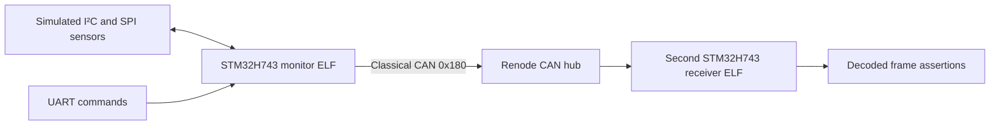

# STM32 Machine Health Monitor

A small freestanding C firmware project for an **STM32H743 (Cortex-M7)**. Two emulated MCUs run the monitor and CAN receiver; Renode models USART3, I²C1, SPI4, FDCAN1, SysTick, sensors, and the CAN hub.

`make demo` builds the ARM firmware, runs the two-node scenario, and asserts frames received by the second MCU. No plotting library is needed. Captures: [`evidence/demo.txt`](evidence/demo.txt) and [`evidence/integration.json`](evidence/integration.json).

| Receiver time | Observation | Received CAN payload (hex) |
| ---: | --- | --- |
| 0 ms | Before the first valid temperature sample (temperature defaults to zero) | `0000000000000000` |
| 500 ms | 25.0°C, 100 mg, no flags | `fa00640000010000` |
| 700 ms | 900 mg crosses the 400 mg threshold | `fa00840301020000` |
| 900 ms | 400 mg equals the threshold; alarm clears | `fa00900100030000` |
| 1500 ms | Temperature response is missing; both flags set | `fa00840303060000` |
| 2000 ms | Periodic CAN continues during the missing response | `fa00840303080000` |
| 2500 ms | −12.3°C restored; temperature fault clears | `85ff8403010b0000` |

## Quick start

On Linux x86-64, install `build-essential`, Python 3, `curl`, and `tar`:

```sh
./tools/bootstrap.sh
make demo
```

The bootstrap downloads checksum-verified, pinned ARM GCC and Renode archives into `.tools/`. To use installed tools, pass their paths:

```sh
make ARM_GCC=/path/to/arm-none-eabi-gcc RENODE=/path/to/renode demo
```

`make demo` runs the receiver-asserted `make integration` scenario. `make host-test` runs native C tests with AddressSanitizer and UndefinedBehaviorSanitizer; `make probe` runs an earlier peripheral check. Python uses its standard library. Localhost sockets and emulator execution must be available; failed runs leave diagnostics in `build/`.

## How it fits together



The main loop samples acceleration every 100 ms and temperature every 500 ms, services bounded UART input, and sends telemetry at startup, every 500 ms, and on flag changes. SysTick advances milliseconds; bounded peripheral waits keep a failed temperature read from blocking forever. The last valid value is retained and a fault flag is set. This is an emulation demonstration, not a board support package.

## Interfaces

**UART:** 115200 baud, 8-N-1; commands end in LF, CR, or CRLF. `status` reports time, readings, threshold, and flags; `threshold <mg>` accepts unsigned values from 100 through 4000 (default 1500). Lines are limited to 63 characters. Errors are reported and the parser recovers for the next line.

**Simulated sensors:** these deterministic Renode devices are demo models, not
claims of compatibility with commercial parts. Values are little-endian signed
integers.

| Bus/device | Register data |
| --- | --- |
| I²C1 temperature, address `0x48` | `0x00–01`: signed tenths °C (default 250); `0x02`: ID `0x54` |
| SPI4 accelerometer | `0x00–01`: X mg; `0x02–03`: Y mg; `0x04–05`: Z mg; `0x06`: ID `0x41` |

Vibration is `max(abs(X), abs(Y))`; Z is read but excluded. The alarm is strict
`vibration > threshold`, so equality clears it. Temperature failures preserve
the last good reading. A successful reading clears only the temperature fault.

**CAN:** Classical standard data frame, ID `0x180`, DLC 8. Payload bytes:

| Bytes | Meaning |
| --- | --- |
| 0–1 | Last valid signed temperature in tenths °C, little-endian; zero before the first successful read |
| 2–3 | Unsigned vibration in mg, little-endian |
| 4 | Bit 0 vibration alarm; bit 1 temperature fault; other bits zero |
| 5 | Sequence, incremented after a frame is queued; wraps modulo 256 |
| 6–7 | Reserved, zero |

## Interview walkthrough

1. **Where do decisions live?** [`monitor_core.c`](firmware/monitor_core.c)
   holds command parsing, state transitions, and explicit byte serialization;
   [`board.c`](firmware/board.c) performs memory-mapped peripheral I/O.
2. **How is work scheduled?** [`main()`](firmware/monitor.c#L55) polls UART,
   samples SPI/I²C on separate deadlines, and tracks periodic and event frames
   independently—even when both are due together.
3. **How is vibration handled?** [`monitor_acceleration()`](firmware/monitor_core.c#L35)
   promotes before negation (so `INT16_MIN` becomes 32768 safely), takes the
   larger X/Y magnitude, and applies the strict threshold. The test asserts
   equality clears and the signed minimum remains representable
   ([`test_alarm()`](tests/test_core.c#L45)).
4. **What happens when temperature stops responding?**
   [`temperature_read()`](firmware/board.c#L91) exits its bounded receive poll;
   [`monitor_temperature()`](firmware/monitor_core.c#L28) retains the old
   value and sets the fault. This Renode model exercises a **missing response**
   and timeout; it does not implement or verify a physical I²C NACK path.
5. **How do we know CAN arrived?** [`can_receive()`](firmware/board.c#L148)
   reads the second MCU's FIFO. [`assert_received_payloads()`](tests/integration.py#L143)
   checks ID, DLC, frame format, exact encoding, reserved bytes, and sequence;
   [`assert_full_sequence()`](tests/integration.py#L243) checks scenario states
   and continued frames during the sensor fault.

## Scope and evidence

All validation is in Renode: ARM execution, UART RX/TX, I²C reads and missing-response timeout, SPI reads, CAN message RAM and hub delivery, and second-MCU decoding. GPIO alternate-function routing, electrical waveforms, physical timing, clock-stretching, physical I²C NACK, CAN electrical error recovery, and real sensors are not validated. See [validation notes and tool provenance](docs/validation.md).

## Manual exercise

In [`full_sequence()`](tests/integration.py#L171), change only the alarm
injection from `X -900` to `X 900`, then run `make demo`. The test should still
pass with the same 900 mg receiver reading and payload
`fa00840301020000`: the sign changes, while the absolute magnitude does not.
Restore `X -900` after the exercise.
