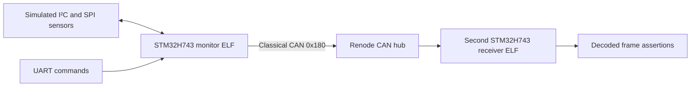

# STM32 Machine Health Monitor

A small freestanding C firmware project for an **STM32H743 (Cortex-M7)**. Two emulated MCUs run the monitor and CAN receiver; Renode models USART3, I²C1, SPI4, FDCAN1, SysTick, sensors, and the CAN hub.

`make demo` builds the ARM firmware, runs the two-node scenario, and asserts frames received by the second MCU. The captured 3.6-second run received 17 CAN frames. No plotting library is needed. Captures: [`evidence/demo.txt`](evidence/demo.txt) and [`evidence/integration.json`](evidence/integration.json).

| Receiver time | Observation | Received CAN payload (hex) |
| ---: | --- | --- |
| 0 ms | Before the first valid temperature sample (temperature defaults to zero) | `0000000000000000` |
| 500 ms | 25.0°C, 100 mg, no flags | `fa00640000010000` |
| 700 ms | 900 mg crosses the 400 mg threshold | `fa00840301020000` |
| 900 ms | 400 mg equals the threshold; alarm clears | `fa00900100030000` |
| 1500 ms | Temperature response is missing; both flags set | `fa00840303060000` |
| 2000 ms | Periodic CAN continues during the missing response | `fa00840303080000` |
| 2500 ms | −12.3°C restored; temperature fault clears | `85ff8403010b0000` |

## Quick start

On Linux x86-64, install `build-essential`, Python 3, `curl`, and `tar`. The
checked-in evidence was produced with xPack ARM GCC 15.2.1-1.1 and Renode
1.17.0; pinned archives and provenance are documented in
[`docs/validation.md`](docs/validation.md).

```sh
./tools/bootstrap.sh
make demo
```

The bootstrap downloads checksum-verified, pinned ARM GCC and Renode archives into `.tools/`. To use installed tools, pass their paths:

```sh
make ARM_GCC=/path/to/arm-none-eabi-gcc RENODE=/path/to/renode demo
```

`make demo` runs the receiver-asserted `make integration` scenario. `make host-test` runs native C tests with AddressSanitizer and UndefinedBehaviorSanitizer; `make probe` runs an earlier peripheral check. Python uses its standard library. Localhost sockets and emulator execution must be available; failed runs leave diagnostics in `build/`.

## Architecture



The main loop samples acceleration every 100 ms and temperature every 500 ms, services bounded UART input, and sends telemetry at startup, every 500 ms, and on flag changes. SysTick advances milliseconds; bounded peripheral waits keep a failed temperature read from blocking forever. The last valid value is retained and a fault flag is set. This is an emulation demonstration, not a board support package.

## Interfaces

**UART:** 115200 baud, 8-N-1; commands end in LF, CR, or CRLF. `status` reports time, readings, threshold, and flags; `threshold <mg>` accepts unsigned values from 100 through 4000 (default 1500). Lines are limited to 63 characters. Errors are reported and the parser recovers for the next line.

**Simulated sensors:** these deterministic Renode devices are demo models, not
claims of compatibility with commercial parts. Values are little-endian signed
integers.

| Bus/device | Register data |
| --- | --- |
| I²C1 temperature, address `0x48` | `0x00–01`: signed tenths °C (default 250); `0x02`: ID `0x54` |
| SPI4 accelerometer | `0x00–01`: X mg; `0x02–03`: Y mg; `0x04–05`: Z mg; `0x06`: ID `0x41` |

Vibration is `max(abs(X), abs(Y))`; Z is read but excluded. The alarm is strict
`vibration > threshold`, so equality clears it. Temperature failures preserve
the last good reading. A successful reading clears only the temperature fault.

**CAN:** Classical standard data frame, ID `0x180`, DLC 8. Payload bytes:

| Bytes | Meaning |
| --- | --- |
| 0–1 | Last valid signed temperature in tenths °C, little-endian; zero before the first successful read |
| 2–3 | Unsigned vibration in mg, little-endian |
| 4 | Bit 0 vibration alarm; bit 1 temperature fault; other bits zero |
| 5 | Sequence, incremented after a frame is queued; wraps modulo 256 |
| 6–7 | Reserved, zero |

## Implementation and validation

[`monitor_core.c`](firmware/monitor_core.c) contains command parsing, state
transitions, vibration thresholding, and CAN payload serialization;
[`board.c`](firmware/board.c) implements memory-mapped peripheral access.
[`main()`](firmware/monitor.c#L55) schedules sensor reads and CAN transmission
while polling UART. Magnitudes promote signed samples before negation, including
`INT16_MIN` ([`monitor_acceleration()`](firmware/monitor_core.c#L35),
[`test_alarm()`](tests/test_core.c#L45)). Bounded I²C polling preserves the last
valid temperature and raises a fault on a missing response
([`temperature_read()`](firmware/board.c#L91),
[`monitor_temperature()`](firmware/monitor_core.c#L28)).

Run `make all` to build both ARM ELFs, `make host-test` for native C tests with
AddressSanitizer and UndefinedBehaviorSanitizer, `make probe` for the peripheral
probe, `make integration` for receiver-side frame assertions, or `make demo` to
run that same integration scenario. The integration assertions check CAN ID,
DLC, frame format, payload encoding, reserved bytes, sequence, scenario states,
and continued frames during the sensor fault
([`assert_received_payloads()`](tests/integration.py#L143),
[`assert_full_sequence()`](tests/integration.py#L243)). Captured receiver frames
and monitor console output are in [`evidence/demo.txt`](evidence/demo.txt);
counts, tool versions, stage intervals, and ELF hashes are in
[`evidence/integration.json`](evidence/integration.json).

## Scope and evidence

All validation is in Renode: ARM execution, UART RX/TX, I²C reads and missing-response timeout, SPI reads, CAN message RAM and hub delivery, and second-MCU decoding. GPIO alternate-function routing, electrical waveforms, physical timing, clock-stretching, physical I²C NACK, CAN electrical error recovery, and real sensors are not validated. See [validation notes and tool provenance](docs/validation.md).
